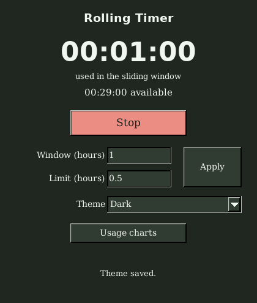

# Rolling Timer

A small Rust desktop stopwatch that shows **how much time you used within the
last N hours**, and optionally how much remains under a quota. Older usage expires
continuously, including while the stopwatch is stopped.

For example, choose a **24-hour window** and a **3-hour limit**, then press Start
while using a limited service and Stop when finished. This is manual tracking:
the app does not connect to ChatGPT, inspect your microphone, or know your account's
actual limits. You can use any window and quota that fit your activity.



## Use

1. Open Rolling Timer and press **Start** to begin a session.
2. Press **Stop** when finished. Sessions checkpoint automatically every second.
3. Edit **Window (hours)** and optional **Limit (hours)**, then press **Apply** or
   Enter. Decimal hours work; blank limit means usage-only tracking.
4. Choose **Dark**, **Light**, **Mocha**, or **Cappuccino** in the **Theme** menu.
   Changes apply immediately to the timer and graphs and are saved automatically.
5. Open **Usage charts** for two graphs: minutes used per time bucket in
   the selected past window, and rolling usage over the next window if you stop
   adding usage now. Both time axes show calendar dates and local clock times.
   Hover over the plots to inspect usage, minutes released and optional quota
   available directly on the graph. The forecast marks when usage reaches zero.
   All displayed dates use the operating system's timezone; storage stays UTC.
6. Close the window to save the final checkpoint. Ctrl+Q also exits (Command+Q on
   macOS); Escape closes the graphs while keeping the timer open.

Data lives in `~/.rolling_timer/` (`%USERPROFILE%\.rolling_timer` on Windows).
For portable storage next to your downloaded executable, launch it with:

```sh
rolling-timer --data-dir ./timer-data
```

Theme preferences live in `config.toml` in the same data directory, as one string:

```toml
theme = "mocha"
```

Accepted values are `dark` (default), `light`, `mocha`, and `cappuccino`. Editing the
menu atomically replaces the config while preserving other keys and comments.
Timer window/quota settings and usage remain in SQLite. A forecast does **not**
stop an active session; it is a conditional preview that refreshes while open.
Released minutes and available quota are distinct when usage exceeds your limit.

An abrupt interruption retains the last committed tick. Reopening always starts
stopped; the program never guesses usage while it was not running. Sleep/suspend
counts while recording. Backwards clock changes produce an error until the clock
catches up. Two instances cannot use the same data directory concurrently.

## Build and develop

The development environment is pinned in `flake.lock` and includes Rust, Cargo,
Clippy, rustfmt, C/C++ build tools, Just, LLVM coverage tooling, and Linux GUI test
tools. No global package installation is necessary.

```sh
nix develop
just check
cargo run -- --data-dir .scratch/demo
```

Direnv users can run `direnv allow` to activate the supplied `.envrc` (`use flake`).
Without Nix, use the version in `rust-toolchain.toml`, a C/C++ compiler, CMake and
Ninja. Linux additionally needs X11 development headers/libraries and Fontconfig:
`libx11-dev libxext-dev libxft-dev libxinerama-dev libxcursor-dev libxrender-dev
libxfixes-dev libfontconfig1-dev` on Debian/Ubuntu. Windows uses the MSVC toolchain;
macOS uses Xcode Command Line Tools. SQLite and FLTK compile from Cargo sources.

Useful tasks:

| Command | Purpose |
| --- | --- |
| `just check` | Formatting, strict Clippy, tests, real widgets, real X11 input |
| `cargo test --no-default-features` | Domain, state machine, CLI parser and SQLite without a GUI |
| `just gui-test` | Widget callbacks, labels, validation, errors and close persistence |
| `just gui-e2e` | Linux executable driven by actual keyboard/mouse events |
| `just coverage` | Full Rust line coverage, HTML/LCOV reports and strict 100% gate |
| `nix develop .#nightly -c just miri` | Pure accounting and chart tests under Miri with strict provenance |
| `nix develop .#nightly -c just asan` | AddressSanitizer for Rust and bundled SQLite |
| `nix develop .#nightly -c just asan-gui` | Address/LeakSanitizer for Rust, SQLite and FLTK widgets |
| `just ubsan-sqlite` | UndefinedBehaviorSanitizer for SQLite |
| `just inspect` | Build a native release and inspect its size/dynamic dependencies |
| `just benchmark-static-size` | Controlled static comparisons: native sections, SQLite extensions, Rust s/z |
| `nix develop .#cross -c just cross-linux-arm64` | Build core tests with Zig and execute them with QEMU |
| `nix develop .#cross -c just cross-windows` | Cross-build MSVC, run tests/widgets in Wine, verify embedded CRT |
| `nix develop .#cross -c just cross-windows-arm64-build` | Compile ARM64 Windows release/tests; runtime remains a separate gate |

Headless Linux GUI tests start an isolated Xvfb automatically. macOS/Windows need
a native desktop session for widget tests. Miri intentionally uses a small,
fixed property-test seed; normal CI runs 1,000 cases per property. Temporary logs,
coverage output and experiments belong in ignored `.scratch/`.
See [the cross-platform matrix](docs/CROSS_TESTING.md) for the distinction between
compiling a target, executing in Wine/QEMU and validating a native OS.

## Portable releases

The release workflow builds Linux x86-64/ARM64, Windows x86-64, and macOS Intel/Apple
Silicon archives with SHA-256 checksums. Extract the archive and run the included executable. A version tag creates a **draft** GitHub release
for review; a manual workflow run only uploads build artifacts. The local work does
not publish a release automatically.

The Linux release target is `nix build .#static`: musl, SQLite, FLTK, X11 client
libraries and font libraries are statically linked, and the build rejects an ELF
interpreter or dynamic `NEEDED` entries. A running X11/XWayland display and desktop
fonts/configuration remain necessary. Native Wayland-only sessions without
XWayland are not supported by this deliberately small backend.

On an x86-64 Linux host, `nix build .#static-arm64` cross-compiles the complete
ARM64 Linux desktop and runs its integration suite through QEMU. Use
`nix develop .#cross -c ./scripts/test-static-arm64.sh result/bin/rolling-timer`
to drive that executable with real X11 input. Root/binfmt registration is unnecessary.

The Linux x86-64 static executable with local calendar charts is **4.13 MB**
(**2.52 MB** archived with full notices).
The initial themes/graphs build was **4.07 MB**, compared with the earlier
**4.00 MB** build that had been reduced from **5.80 MB**. Updated review packages
and validation are recorded in [the chart review](docs/THEMES_AND_CHARTS.md). This uses compiler/linker elimination
of unused native sections and a reduced SQLite configuration, with no executable
packer. The [size investigation](docs/SIZE.md) records controlled comparisons,
including the small effect of further Cargo feature reductions.

The default `cargo build --release` / `nix build` is a **development/native** build:
on Linux it still links system X11/font libraries. Do not distribute that artifact
as the fully static release by mistake. The Nix-built native binary also contains
Nix runtime paths.

Windows embeds the C runtime and uses OS-provided Win32 DLLs. macOS uses the system
Cocoa frameworks and libSystem. “Single downloadable executable” means no Python,
external SQLite, FLTK installation or webview; it does not mean replacing each
operating system's native APIs. See the
[FLTK distribution FAQ](https://fltk-rs.github.io/fltk-rs/FAQ.html) and
[Rust CRT linkage reference](https://doc.rust-lang.org/reference/linkage.html).

## Moving from the Python prototype

The original `rolling_timer.py` is retained as a reference. On first launch Rust
transactionally imports its SQLite sessions and optional `config.toml`, preserving
the original table and config during import. Theme changes later update only the
config preference, keeping legacy settings and comments. Import runs exactly once. Invalid data prevents
migration and is reported instead of discarded. Back up the data directory before
switching versions; continuing to use Python after importing does not synchronize
its later sessions into Rust.

Timestamps retain millisecond precision; finer Python timestamp fractions are
truncated. Overlapping imported sessions count once rather than twice. The user
interface now saves edited settings explicitly with Apply/Enter.

## Review and guarantees

The implementation is split into a pure interval model, an injected persistence
interface/state machine, SQLite storage and a thin FLTK adapter. Our Rust code
forbids `unsafe` and denies explicit panics, unwrap/expect, unchecked time subtraction
and unchecked indexing. Expected failures propagate through `Result` and remain
visible in the UI.

The standard library, allocator, FLTK wrapper and native SQLite/FLTK code prevent
an honest absolute guarantee of “no possible panic/abort/undefined behavior.”
Sanitizers and Miri are checked evidence for executed paths, not a proof about all
dependencies. Likewise, the **100% line coverage target** is distinct from branch
coverage or native C/C++ coverage. Current checks, screenshots and the remaining
LeakSanitizer finding are recorded in
[the themes and charts review](docs/THEMES_AND_CHARTS.md); the earlier platform
baseline is in [docs/VALIDATION.md](docs/VALIDATION.md).

Read [the design review](docs/ARCHITECTURE.md) for state transitions, arithmetic
invariants, failure atomicity, migration and distribution tradeoffs. Third-party
components are listed in [docs/THIRD_PARTY.md](docs/THIRD_PARTY.md). License: MIT.
