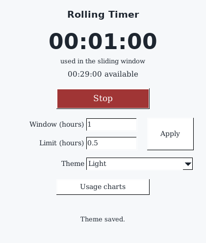
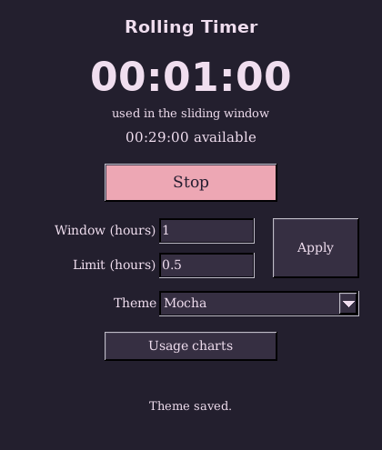
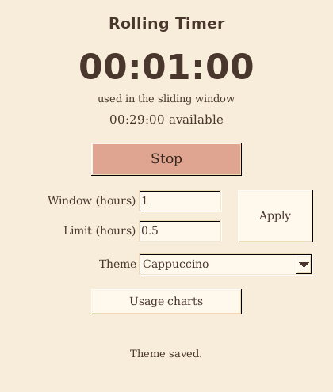
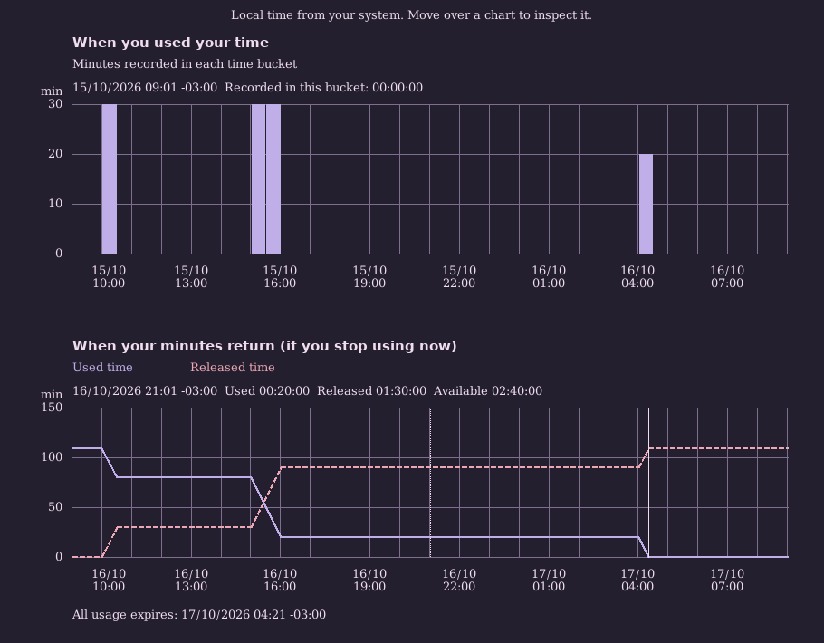

# Themes and usage charts

The theme menu applies Dark, Light, Mocha or Cappuccino immediately to both
windows. It writes one root entry in the profile's `config.toml`:

```toml
theme = "mocha"
```

Missing preferences default to Dark. Unknown names, non-string values, malformed
TOML and file failures are reported. Failed writes leave the previous theme
selected. Saving preserves comments and unrelated entries, including the Python
prototype's window setting. Fresh profiles may contain only the theme entry.

| Dark | Light |
| --- | --- |
|  |  |
| Mocha | Cappuccino |
|  |  |

## History and conditional forecast

The **Usage charts** button opens two graphs:

- History partitions the configured past window into at most 48 buckets. Each
  bar measures minutes used in that bucket; their total equals the timer.
- Forecast shows usage still counted in the sliding window over the next window,
  assuming no more usage is added. Solid/dashed curves distinguish used and
  released time. Both plots have absolute local date/time axes, with hourly grid
  lines for a day-long window and integer minute scales. Hover directly over a
  plot to inspect its timestamp and values, including available quota. A marker
  identifies when usage reaches zero. There is no slider or detached timer.

Dates follow the operating system's timezone, including the offset applicable at
that specific date. Midnight, half-hour offsets and DST folds/gaps are handled in
presentation; persisted UTC timestamps and usage arithmetic are unchanged.



Overlapping imported sessions count once. Forecast points include every session
boundary shifted by the window, so interpolation preserves the actual expiry
curve instead of estimating it from coarse history bars. Available quota saturates
at zero independently of expired usage. An active session continues recording:
the forecast is conditional and refreshes every second while visible. Closing the
graphs or pressing Escape keeps the timer open; Ctrl+Q/Command+Q exits through the
normal checkpoint path from either window. Refresh errors appear in both windows.

The accounting model is in `src/charts.rs`, preferences in `src/preferences.rs`,
and FLTK drawing in `src/gui/charts.rs`. No plotting dependency was added.
`toml_edit` replaces the previous TOML parser to preserve formatting; `tempfile`
provides same-directory atomic replacement. Direct dependencies retain disabled
default features.

## Earlier validation on 2026-10-16

These counts, sizes and cross-platform runs describe the first chart iteration.
The calendar-axis revision below supersedes its presentation and validation.

- `just check`: formatting, strict Clippy, full suite, real widgets and real X11
  mouse/keyboard events passed. Property suites ran 1,000 cases per property.
- `just coverage`: **1,041/1,041 application Rust lines, 100%**;
  **117/117 functions, 100%**; **1,813/1,849 regions, 98.05%**. No application
  module is excluded. This is line coverage, not a claim of full branch coverage.
- `nix develop .#nightly -c just miri`: pure domain and pure chart tests passed
  with strict provenance, including deterministic property cases. The SQLite
  integration case is explicitly skipped because Miri cannot run its native FFI.
- `nix develop .#cross -c just cross-windows`: Windows x86-64 MSVC tests, widgets,
  PE import checks and actual release mouse/keyboard automation passed in Wine.
  The release executable is **1,822,208 bytes**, with no external CRT DLL imports.
  Wine is compatibility testing, not a native Windows installation.

The Linux ARM64 core suite (including the new projection and configuration
tests) also passed through cargo-zigbuild and QEMU. Its GUI has not been rerun.

The updated Linux x86-64 static build passed the Nix release test suite and the
actual-executable X11 scenario. `readelf` shows no ELF interpreter or dynamic
section. The executable is **4,069,880 bytes**, an increase of **65,704 bytes
(1.64%)** over the previous 4,004,176-byte baseline with the same size settings.
This measures the cost of the new behavior, not an optimization comparison.

Local review archives include full notices and SHA-256 sidecars in
`.scratch/release/themes-and-charts/`:

| Target | Archive bytes | SHA-256 |
| --- | ---: | --- |
| Linux x86-64 static | 2,482,754 | `b32ae4f5c8506834c16d930a7daffdeca33ab9bad9d81d57286992a42daee53a` |
| Windows x86-64 | 1,320,338 | `f7259ce34d10e324842d3dfc019d27fd8257d0809cd9dac9b2b73edc75175783` |

These are review artifacts, not a published or sanitizer-approved release.

The GUI scenarios cover every palette, save/reopen, rejected TOML writes and menu
rollback, active forecasts, direct plot interaction, quota input, missing quota, backward
clocks, hidden-window behavior, independent closure and explicit root deletion.
Pure tests compare forecasts against recomputed sliding-window usage and verify
history partitioning, overlaps, clipping, empty usage, quota saturation and date
boundaries. Configuration tests verify that failed publication keeps the previous
file and removes the temporary file.

### Remaining sanitizer finding

`nix develop .#nightly -c just asan-gui` currently **fails LeakSanitizer**. The
scenario completes and no invalid-access diagnostic was observed, but one recorded
run reports **17,916 bytes in 400 allocations** at shutdown. Stack traces point to
Fontconfig patterns opened through FLTK/Xft and fltk-rs 1.5.23 widget-deletion
callbacks using `add_timeout3`. This is not treated as a passing sanitizer gate;
leak detection remains enabled and no suppression was added. Attribution follows
the observed stacks; a complete dependency fix remains outstanding.

For a more detailed allocation stack, run with
`ASAN_OPTIONS=fast_unwind_on_malloc=0`. Logs from this investigation remain in
`.scratch/themes-asan-stack.log`. The optional screenshot helper now uses an owned
FLTK image surface: the wrapper's `capture_window` path leaked its copied native
pixel buffer and could read an uninitialized double buffer before exposure.
Screenshots are rendered from the actual widgets with deterministic test data.

The [earlier portability record](VALIDATION.md) predates these UI additions.
macOS, Windows ARM64 and Linux ARM64 have not yet rerun these new GUI scenarios.
No release was published.

## Calendar-axis revision

The new presentation replaces relative hour labels and the slider with calendar
axes, direct inspection and two labelled expiry curves. Numeric minute ticks
round upwards: a 22.3-minute maximum yields 0, 5, 10, 15, 20, 25. Hour grid lines
remain visible even when only every third/fourth hour fits a text label.

Tests inject fixed and synthetic seasonal timezones and also launch isolated OS
local-time subprocesses for UTC, -03:00, +05:30 and a POSIX seasonal rule. They
verify date changes, both sides of repeated hours and missing spring hours. The
mouse/keyboard scenario inspects both plots, drags over the forecast, leaves the
plot and closes/reopens the windows. The earlier byte sizes and archive hashes above are historical.

Final calendar revision checks on 2026-10-16:

| Check | Result |
| --- | --- |
| Formatting, Clippy with warnings denied, full functional suite | Passed |
| Real widgets and executable mouse/keyboard inspection in Xvfb | Passed |
| Rust application line coverage | **1,216/1,216, 100%** |
| Function / region coverage | **134/134 functions; 2,081/2,118 regions (98.25%)** |
| Miri: pure accounting, projections and calendar axes | Passed; five axis scenarios include the short-window DST fold |
| Windows x86-64 MSVC suite, widgets, CRT imports and Wine executable UI | Passed |
| Linux x86-64 static release tests and actual executable X11 interaction | Passed; no dynamic ELF section |
| AddressSanitizer/LeakSanitizer GUI | Leak gate still fails: 17,876 bytes in 398 allocations in the recorded run; no invalid-access report observed |

The current Linux static executable is **4,131,336 bytes** and the Windows
executable is **1,832,448 bytes**. Local review packages are under
`.scratch/release/local-calendar/`. No release was published. Windows testing
uses Wine; macOS and ARM GUI scenarios were not rerun for this revision.

One X11 process-test attempt reported FLTK's generic event-loop interruption
error while reopening a window. Subsequent native and packaged-static runs
passed. No additional event-loop change was made; the earlier sanitizer finding
also remains open. Logs are retained under `.scratch/calendar-*.log`.

Final local-calendar review archives (full notices and SHA-256 sidecars included):

| Target | Archive bytes | SHA-256 |
| --- | ---: | --- |
| Linux x86-64 static | 2,519,816 | `fa61c45d4a196794ebe083c4b4fc4c8ea96cfe275a0bc3593167140e37383fb0` |
| Windows x86-64 | 1,435,087 | `58f69d670213ecdbb69728227474dbb3f7bd49c9cb66b3972f97ca943962630f` |

The local-time subprocess suite also passed with an injected `env` runner,
exercising the argument-prefix path used by QEMU cross tests. The current
screenshots use a deterministic sample history and an OS timezone override for
São Paulo; the application itself uses `chrono::Local`, never a hardcoded zone.
